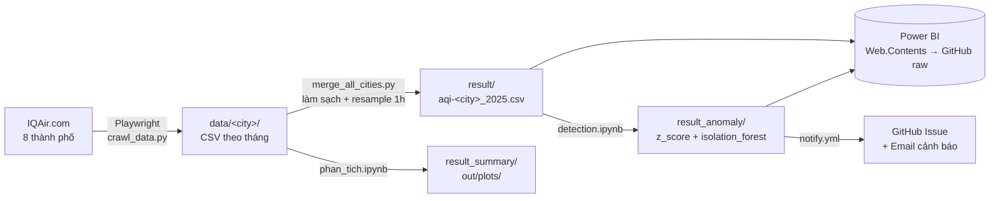
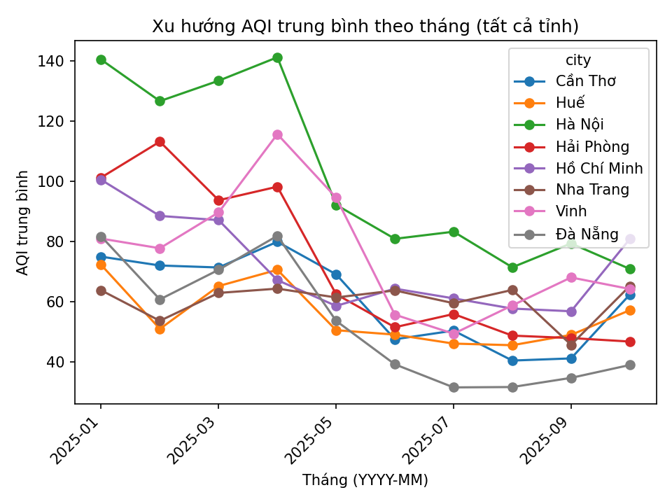
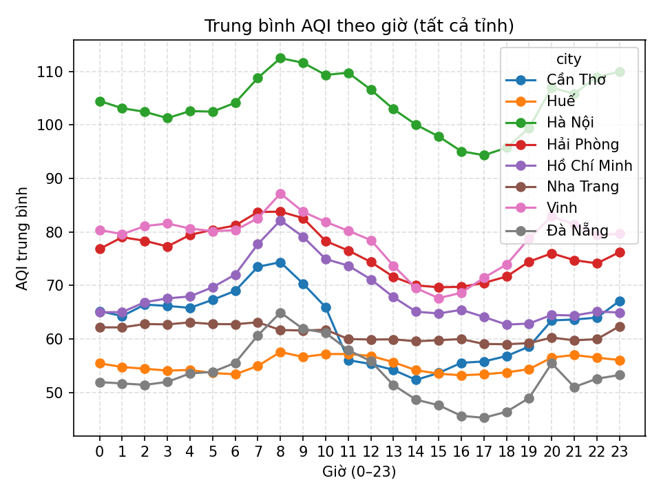
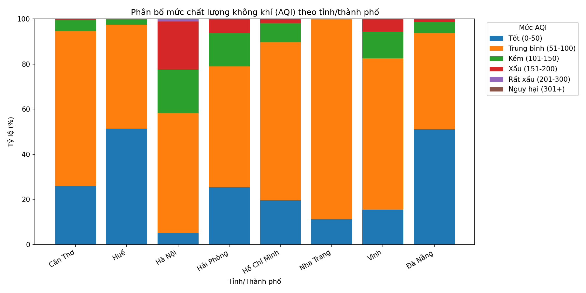
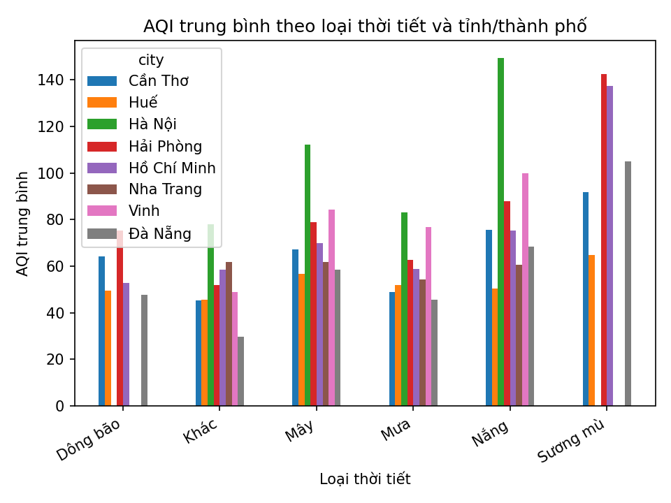

# Automatic Anomaly Detection System

[](https://github.com/heydaisyilu/Automatic-Anomaly-Detection-System/actions/workflows/crawl.yml)
[](https://github.com/heydaisyilu/Automatic-Anomaly-Detection-System/actions/workflows/merge_all_cities.yml)
[](https://github.com/heydaisyilu/Automatic-Anomaly-Detection-System/actions/workflows/phan_tich.yml)

Hệ thống **tự động thu thập dữ liệu chất lượng không khí (AQI)** của 8 thành phố Việt Nam, **phát hiện điểm bất thường** bằng thống kê (Z-score) và học máy (Isolation Forest), rồi trực quan hóa trên **dashboard Power BI**.

Toàn bộ pipeline chạy trên **GitHub Actions**, không cần máy chủ riêng: dữ liệu được cào, làm sạch, phân tích và commit ngược lại vào repo. Power BI đọc thẳng các file CSV từ GitHub nên chỉ cần bấm *Refresh* là có số liệu mới.

> Đồ án môn **Trí tuệ nhân tạo** – Trường Đại học Giao thông Vận tải TP.HCM (UTH).

---

## Mục lục

- [Kiến trúc](#kiến-trúc)
- [Nguồn dữ liệu](#nguồn-dữ-liệu)
- [Cấu trúc thư mục](#cấu-trúc-thư-mục)
- [Các workflow GitHub Actions](#các-workflow-github-actions)
- [Phát hiện bất thường](#phát-hiện-bất-thường)
- [Phân tích dữ liệu](#phân-tích-dữ-liệu)
- [Dashboard Power BI](#dashboard-power-bi)
- [Chạy trên máy cá nhân](#chạy-trên-máy-cá-nhân)
- [Cấu hình secrets](#cấu-hình-secrets)
- [Hạn chế hiện tại & hướng phát triển](#hạn-chế-hiện-tại--hướng-phát-triển)

---

## Kiến trúc



Chuỗi tự động: `Crawl IQAir Data` (theo lịch) → `Merge AQI Data for All Cities` → `Analyze AQI`. Mỗi bước được kích hoạt bằng `workflow_run` khi bước trước chạy xong, và mỗi bước tự commit kết quả của mình vào nhánh `main`.

## Nguồn dữ liệu

Dữ liệu được cào từ trang [IQAir](https://www.iqair.com/vi/vietnam) bằng Playwright (Chromium headless). Mỗi lần chạy lấy một bản ghi cho mỗi thành phố:

| Cột | Ý nghĩa | Ví dụ |
|---|---|---|
| `timestamp` | Thời điểm cào (giờ Việt Nam, ISO 8601) | `2025-08-16T19:00:12.483915+07:00` |
| `city` | Tên thành phố | `Hồ Chí Minh` |
| `aqi` | Chỉ số AQI (US), 0–500 | `87` |
| `weather_icon` | Đường dẫn icon thời tiết của IQAir | `/dl/web/weather/...` |
| `wind_speed` | Tốc độ gió | `12.3 km/h` |
| `humidity` | Độ ẩm | `78%` |

**8 thành phố:** Hà Nội, Hồ Chí Minh, Đà Nẵng, Hải Phòng, Nha Trang, Cần Thơ, Huế, Vinh.

Bản ghi nào thiếu một trong bốn trường AQI / icon / gió / độ ẩm sẽ bị bỏ qua (không ghi vào CSV).

## Cấu trúc thư mục

```text
├── .github/workflows/          # Các pipeline GitHub Actions (xem bảng bên dưới)
├── crawl_data.py               # Cào AQI + thời tiết từ IQAir
├── merge_all_cities.py         # Gộp CSV theo tháng, làm sạch, resample 1 giờ
├── detection/
│   ├── detection.ipynb         # Z-score + Isolation Forest
│   └── phan_tich.ipynb         # Thống kê mô tả, tương quan, vẽ biểu đồ
├── notify/render_email.py      # Dựng nội dung cảnh báo (Markdown)
├── data/<city>/                # Dữ liệu thô: aqi_<city>_<năm>_<tháng>.csv
├── result/                     # Dữ liệu đã gộp & resample: aqi-<city>_2025.csv
├── result_anomaly/
│   ├── z_score/                # <city>_zscore.csv
│   └── isolation_forest/       # anomalies_<city>_2025.csv
├── result_summary/             # Bảng tổng hợp theo tháng, giờ, mức AQI, thời tiết...
├── out/plots/                  # Biểu đồ PNG sinh tự động
├── Automatic-Anomaly-Detection-Systems.pbix   # Dashboard Power BI
└── requirements.txt
```

## Các workflow GitHub Actions

| Workflow | File | Kích hoạt | Việc làm | Commit vào |
|---|---|---|---|---|
| Crawl IQAir Data | `crawl.yml` | Cron `0 * * * *` (mỗi giờ) + chạy tay | Chạy `crawl_data.py` | `data/` |
| Merge AQI Data for All Cities | `merge_all_cities.yml` | Sau khi crawl xong + chạy tay | Chạy `merge_all_cities.py` | `result/` |
| Analyze AQI | `phan_tich.yml` | Sau khi merge xong + chạy tay | Chạy `phan_tich.ipynb` bằng nbconvert | `result_summary/`, `out/plots/`, `detection/phan_tich_output.ipynb` |
| Detect AQI Anomalies | `detect_anomalies.yml` | **Chạy tay** | Chạy `detection.ipynb` | `result_anomaly/`, `detection/detection_output.ipynb` |
| Notify anomalies by issue | `notify.yml` | **Chạy tay** | Dựng báo cáo, tạo/cập nhật Issue *“AQI/Gió bất thường — Live feed”* và gửi email | – |
| Generate Pull Request Description | `generate_pr_description.yml` | Khi mở/cập nhật PR | Dùng Gemini viết mô tả PR bằng tiếng Việt | – |

> Lịch cron của GitHub không đảm bảo đúng giờ; trên thực tế workflow crawl thường chạy cách nhau vài giờ.

## Phát hiện bất thường

Notebook [`detection/detection.ipynb`](detection/detection.ipynb) chạy hai phương pháp trên dữ liệu đã resample trong `result/`.

### 1. Z-score (thống kê)

Với mỗi thành phố, tính `z = (x − mean) / std` cho **AQI** và **tốc độ gió**. Điểm có `|z| > 3` được gắn cờ bất thường:

- `zscore_flag_aqi = -1` → AQI bất thường
- `zscore_flag_wind = -1` → gió bất thường

Kết quả: `result_anomaly/z_score/<city>_zscore.csv`.

### 2. Isolation Forest (học máy)

- Đặc trưng đầu vào: `AQI`, `wind_speed`, `humidity`
- `contamination` được ước lượng tự động từ độ lệch chuẩn của dữ liệu, giới hạn trong khoảng **1%–10%**
- `random_state = 42` để kết quả lặp lại được
- Cột `anomaly = -1` là điểm bất thường, `1` là bình thường

Kết quả: `result_anomaly/isolation_forest/anomalies_<city>_2025.csv`.

Cuối notebook có **ma trận nhầm lẫn** so sánh hai phương pháp, lấy Z-score làm “nhãn tham chiếu”, để xem Isolation Forest bắt được bao nhiêu điểm mà Z-score cũng đánh dấu.

## Phân tích dữ liệu

Notebook [`detection/phan_tich.ipynb`](detection/phan_tich.ipynb) đọc toàn bộ `data/*/*.csv` và sinh:

| Phân tích | File tổng hợp (`result_summary/`) | Biểu đồ (`out/plots/`) |
|---|---|---|
| AQI trung bình / max / min theo tháng | `aqi_monthly_summary.csv` | `trend_mean_all_cities.png` |
| AQI trung bình theo giờ trong ngày | `aqi_hourly_summary.csv` | `hourly_mean_all_cities.png` |
| Tỷ lệ các mức AQI (Tốt → Nguy hại) theo thành phố | `aqi_distribution_by_city.csv` | `distribution_aqi_by_city.png` |
| Tương quan AQI – tốc độ gió (Pearson, Spearman) | `aqi_vs_windspeed_correlation.csv` | `scatter_aqi_vs_windspeed_*.png` |
| Tương quan AQI – độ ẩm | `aqi_vs_humidity_correlation.csv` | `scatter_aqi_vs_humidity_*.png` |
| AQI trung bình theo loại thời tiết | `aqi_by_weather_and_city.csv` | `aqi_by_weather_and_city.png` |

<p align="center">
  
  
</p>
<p align="center">
  
  
</p>

## Dashboard Power BI

File: [`Automatic-Anomaly-Detection-Systems.pbix`](Automatic-Anomaly-Detection-Systems.pbix) (Power BI Desktop).

### Cách dữ liệu vào Power BI

Mỗi bảng nguồn là một query `Web.Contents` trỏ tới file CSV trên GitHub, ví dụ:

```text
https://raw.githubusercontent.com/heydaisyilu/Automatic-Anomaly-Detection-System/refs/heads/main/result/aqi-hanoi_2025.csv
```

Các query theo từng thành phố được gộp (`Table.Combine`) thành 3 bảng chính:

| Bảng | Nguồn | Nội dung |
|---|---|---|
| `ALL_CITY_AQI` | `result/aqi-<city>_2025.csv` | AQI, gió, độ ẩm theo giờ của 8 thành phố |
| `ANOMALY_Z-Score` | `result_anomaly/z_score/*.csv` | Z-score và cờ bất thường AQI/gió |
| `ANOMALY_ISOLATION_FOREST` | `result_anomaly/isolation_forest/*.csv` | Nhãn bất thường của Isolation Forest |

Các bảng phụ viết bằng DAX: `DimDateTime` (lịch theo giờ), `DimCity`, `AQILevelDim` (6 mức AQI), `MethodSelector`, `MethodDim_Donut`, `ZScoreTypeDim`, và bảng `MEASURE` chứa các measure như `AQI Avg`, `Bad CityHours (>100)`, `City Worst (by Avg AQI)`, `#Anom (Selected)`, `Anom Rate (Selected)`.

### Cập nhật dữ liệu

- **Power BI Desktop:** mở file → *Home* → **Refresh**. Power BI tải lại CSV mới nhất từ GitHub.
- **Power BI Service:** publish báo cáo, vào *Semantic model settings* → *Data source credentials* chọn **Anonymous** cho nguồn Web, rồi bật **Scheduled refresh**. Nguồn là URL công khai nên không cần gateway.

### Các trang báo cáo

**OVERVIEW**

- Thẻ KPI: AQI trung bình, số giờ-thành phố có AQI > 100, thành phố có AQI trung bình cao nhất, gió và độ ẩm trung bình
- Bar chart: xếp hạng thành phố theo số điểm bất thường (Z-score và Isolation Forest đặt cạnh nhau)
- Bản đồ: kích thước bong bóng theo số bất thường, tooltip hiển thị AQI và số bất thường của từng phương pháp
- 3 donut: bất thường AQI so với gió (Z-score), tỷ trọng bất thường theo phương pháp, phân bố số giờ theo mức AQI
- Slicer: khoảng thời gian, tháng, giờ trong ngày, thành phố

**ANALYSIS**

- Combo chart: AQI và độ ẩm trung bình theo tốc độ gió
- Column chart: tốc độ gió và độ ẩm trung bình theo thành phố
- Dùng chung bộ slicer với trang OVERVIEW; có nút chuyển trang ở thanh bên trái

## Chạy trên máy cá nhân

Yêu cầu: Python 3.10+.

```bash
git clone https://github.com/heydaisyilu/Automatic-Anomaly-Detection-System.git
cd Automatic-Anomaly-Detection-System
pip install -r requirements.txt
playwright install chromium
```

Chạy từng bước của pipeline:

```bash
python crawl_data.py            # cào một lượt cho 8 thành phố → data/
python merge_all_cities.py      # gộp + resample → result/
cd detection
jupyter nbconvert --to notebook --execute detection.ipynb --output detection_output.ipynb
jupyter nbconvert --to notebook --execute phan_tich.ipynb --output phan_tich_output.ipynb
```

> Repo có hơn 14.000 commit (phần lớn do bot), nên nếu chỉ cần code mới nhất hãy dùng `git clone --depth 1`.

## Cấu hình secrets

Vào *Settings → Secrets and variables → Actions* của repo:

| Secret | Dùng cho | Ghi chú |
|---|---|---|
| `PAT` | Các workflow push kết quả lên `main` | Personal Access Token có quyền ghi repo. `crawl.yml` bắt buộc phải có; các workflow khác tự dùng `GITHUB_TOKEN` nếu thiếu |
| `GEMINI_API_KEY` | `generate_pr_description.yml` | API key Google Gemini |
| `SMTP_USERNAME`, `SMTP_PASSWORD` | `notify.yml` | Tài khoản Gmail + App Password để gửi email cảnh báo. Địa chỉ nhận (`to:`) và người được tag (`PING_USER`) sửa trực tiếp trong `notify.yml` |

## Hạn chế hiện tại & hướng phát triển

Những điểm nhóm đã biết và đang cần xử lý:

- **Năm 2025 đang bị ghi cứng.** `merge_all_cities.py` (`NAM = 2025`), `detection.ipynb` và các query Power BI đều chỉ đọc file `*_2025`, nên dữ liệu từ năm 2026 không đi tiếp được qua pipeline. Cần đổi sang đọc mọi năm (ví dụ `aqi_<city>_*.csv`) và bỏ hậu tố năm trong tên file kết quả.
- **Crawler có thể lỗi mà không báo.** `crawl_data.py` bỏ qua thành phố khi không đọc được dữ liệu, nhưng vẫn kết thúc thành công kể cả khi cả 8 thành phố đều lỗi (ví dụ IQAir đổi giao diện). Nên cho script trả về mã lỗi khi không lấy được bản ghi nào, để workflow chuyển sang đỏ.
- **Phát hiện bất thường và cảnh báo chưa tự động.** `detect_anomalies.yml` và `notify.yml` đang chỉ chạy tay, nên `result_anomaly/` có thể cũ hơn `result/`. Có thể nối chúng vào chuỗi `workflow_run` sau bước merge.
- **Lịch sử commit phình to.** `phan_tich.yml` commit lại `phan_tich_output.ipynb` sau mỗi lần chạy kể cả khi chỉ đổi metadata. Có thể bỏ notebook output khỏi commit, hoặc chỉ commit khi file CSV/PNG thực sự thay đổi.
- **Power BI:**
  - Cột `Hour` và `Date` của `DimDateTime` bị lệch 1 giờ ở phần lớn các dòng do sai số số thực khi `GENERATESERIES` cộng dồn `TIME(1,0,0)`. Nên làm tròn trước khi tách giờ, ví dụ `VAR v = ROUND([Value] * 24, 0) / 24` rồi dùng `HOUR(v)`, `INT(v)`.
  - Nên tắt *Auto date/time* (đang sinh 26 bảng `LocalDateTable`), tắt *Enable load* cho 24 query theo từng thành phố, và xóa 3 custom visual không dùng để file nhẹ hơn.
  - Nên chuyển về mô hình hình sao: `DimCity` và `DimDateTime` lọc trực tiếp cả 3 bảng fact, bỏ quan hệ nhiều-nhiều hai chiều theo `city` giữa `ALL_CITY_AQI` và hai bảng bất thường.
  - Bản đồ đang định vị bằng tên thành phố. Thêm kinh độ/vĩ độ sẽ tránh việc Bing đặt nhầm những tên ngắn như “Vinh”, “Huế”.

---

## Nhóm thực hiện

Xem danh sách thành viên đóng góp tại [Contributors](https://github.com/heydaisyilu/Automatic-Anomaly-Detection-System/graphs/contributors).
